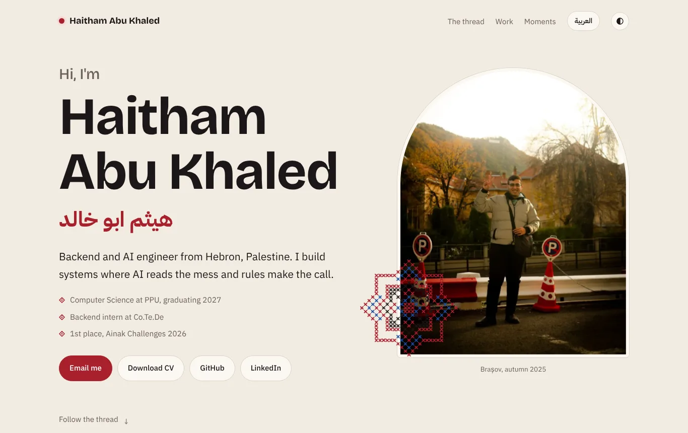
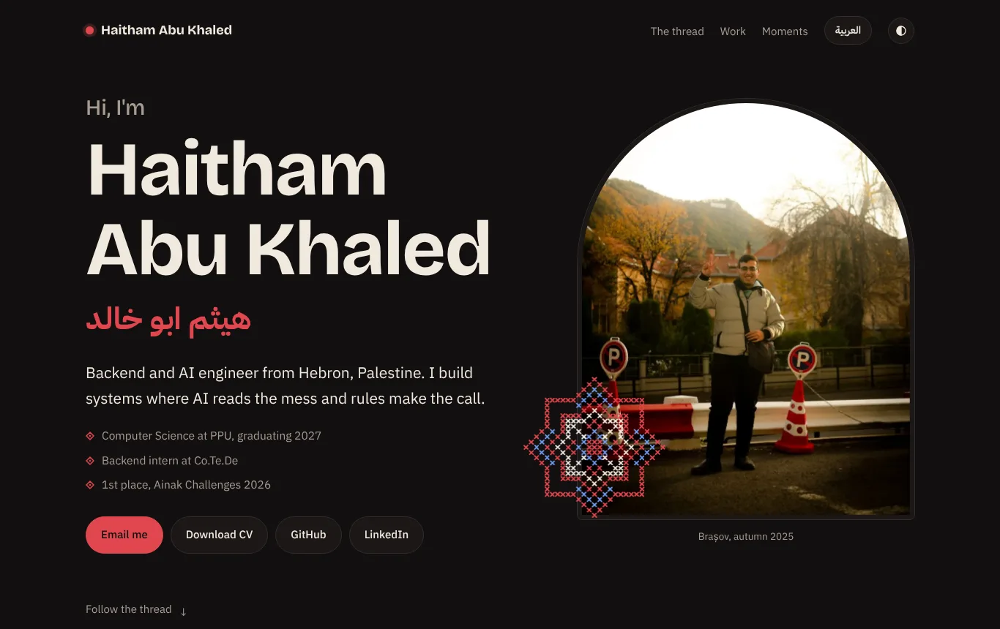
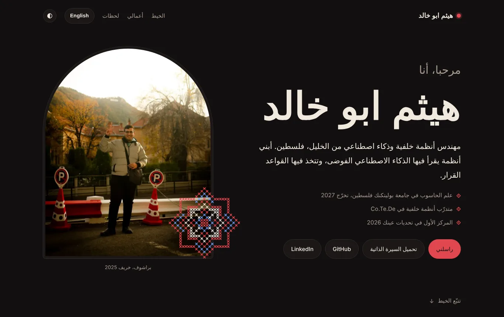
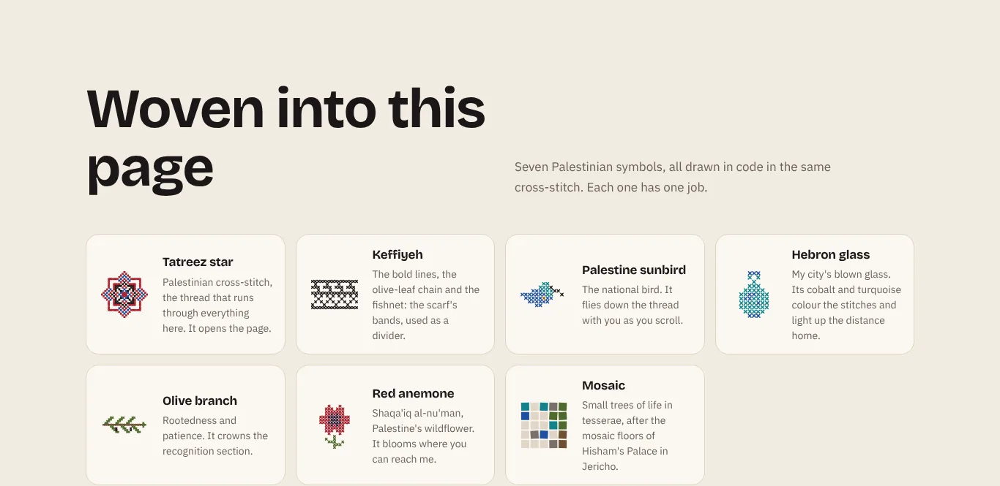
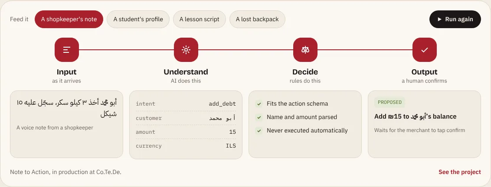

<div align="center">

# Haitham Abu Khaled · هيثم ابو خالد

**Backend & AI engineer from Hebron, Palestine.**
I build systems where AI reads the mess and rules make the call.

### [haithamabukhaled.dev](https://haithamabukhaled.dev)

[LinkedIn](https://www.linkedin.com/in/haitham-abu-khaled/) · [CV (PDF)](https://haithamabukhaled.dev/Haitham_Abu_Khaled_CV.pdf) · [Email](mailto:habwkhald504@gmail.com)

 

</div>

---

This is the source of my personal portfolio. It is a small React app, but most of the work went into three things that a template would not give me: a full Arabic mode with real right-to-left layout, a stitching engine that draws Palestinian embroidery in code, and live demos of my projects that run in the browser.

## What makes it different

### 1. Fully bilingual, with proper RTL



One toggle switches every word on the page between English and Arabic, and the whole layout mirrors. This is done with CSS logical properties (`margin-inline-start`, `inset-inline-*`) rather than duplicate stylesheets, so a single set of styles works in both directions. Mixed Arabic and English runs (names, numbers, code) are wrapped in Unicode bidi isolates so punctuation never jumps to the wrong side. That is the same fix I used in production on the Verbivore video pipeline.

### 2. Palestinian symbols, drawn stitch by stitch



Every pattern on the page comes from one function, `stitch()`, in [`src/lib/stitch.js`](src/lib/stitch.js). It draws a single cross with slight random wobble, like a real thread. Seven motifs are built on top of it in [`src/lib/motifs.js`](src/lib/motifs.js), each defined as a grid of cells:

| Motif | Where it appears |
|---|---|
| Tatreez star | Stitches itself in beside the hero photo |
| Keffiyeh | Section divider (bold lines, olive-leaf chain, fishnet) |
| Palestine sunbird | Flies down the timeline as you scroll |
| Hebron glass | Cobalt and turquoise in the palette and the glow behind "2,371 km" |
| Olive branch | Crowns the Recognition section |
| Red anemone (shaqa'iq al-nu'man) | Blooms beside the contact section |
| Mosaic | Trees of life, after the floors of Hisham's Palace in Jericho |

All motifs read their colours from CSS variables at draw time, so they repaint correctly when switching light and dark mode.

### 3. Live demos instead of screenshots



Each project has a small working piece of its idea, running entirely in the browser:

- **Pipeline machine:** feed one of four inputs through *Input → Understand (AI) → Decide (rules) → Output (human confirms)*.
- **Note to Action:** type a shopkeeper's note in Arabic and watch it parse into a JSON proposal. If the amount or customer is missing, it asks instead of guessing. (A rule-based imitation of the real production service.)
- **MobilityBridge eligibility:** move the sliders and see a deterministic verdict, with the reason for every rule.
- **Verbivore:** the real bidi bug reproduced side by side with its fix, plus a frame-rate slider that recalculates render cost.

## Built with

- **React 18 + Vite 5**, no UI library. Every component is hand-written.
- **Canvas 2D** for all embroidery motifs.
- **CSS custom properties** for theming, `prefers-color-scheme` and `prefers-reduced-motion` respected.
- **GitHub Actions → GitHub Pages**, with a custom `.dev` domain over HTTPS.

## Project structure

```
src/
  content.js          every word on the site, English and Arabic side by side
  App.jsx             language and theme state
  lib/
    stitch.js         the stitch() engine, tatreez star, section bands
    motifs.js         olive, anemone, sunbird, Hebron glass, keffiyeh
  components/
    Hero, Thread, Far, Work, Machine, Moments, Honors, Woven, Contact
    NoteDemo, EligibilityDemo, VerbivoreDemo   the live project demos
public/
  photos/             compressed WebP photos and the pitch video loop
  CNAME               custom domain for GitHub Pages
.github/workflows/
  deploy.yml          builds and publishes on every push to main
```

To change any text, edit `src/content.js`. No component needs touching.

## Run it locally

```bash
npm install
npm run dev       # http://localhost:5173
npm run build     # production build in dist/
```

Pushing to `main` rebuilds and redeploys the live site automatically.

## A note on content

The code is mine to share; feel free to read it and learn from it. The photos, CV and personal text are not licensed for reuse.

<div align="center">

*Stitched like tatreez, coloured like Hebron glass.*

</div>
